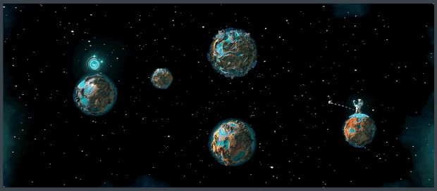

# Swingularity

An interstellar space golf game with procedural generation. Play it on Steam (all profits to charity): [https://store.steampowered.com/app/3272450/Swingularity/](https://store.steampowered.com/app/3272450/Swingularity/).

## Description

An indie space golf game set across an infinite multiverse filled with stylized planets, stars, and other celestial wonders. Bogey, par, or birdie your way through tailored and procedurally generated courses. In Swingularity, the cosmos becomes your fairway.

Swingularity won the Australian STEM Video Game Challenge Opens Category in 2024.

## Acknowledgments

* Developed by Hudson Woolford and Ted Boss
* Music by Kevin Chu
* 3D models by Mickey Chen

* [Built with Unity](https://unity.com/)